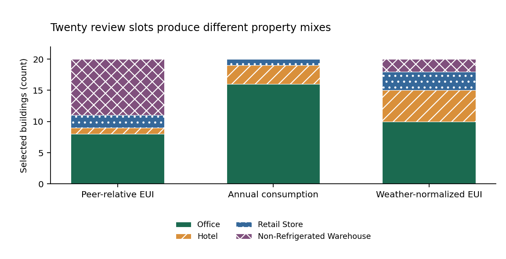

# Choose buildings for an energy review

**Decide where to spend limited review time.** Compare buildings with unusually high energy intensity for their property type, the largest annual energy users, and the highest-intensity properties. The output is a shortlist for checking meter records, operating schedules and equipment.

In this study's **192-building queue**, a hypothetical **20-slot review** selects very different properties: the peer-relative and largest-consumption lists share **only 2 buildings**. Their median floor areas are **41,062.5 ft²** and **707,905.0 ft²**. Peer context puts smaller high-intensity properties on the list; absolute consumption concentrates attention on larger energy users.

**Use the list to investigate, then verify the reason.** A flag does not establish wasted energy, an equipment fault, noncompliance or achievable savings. Engineering usefulness and realized savings have not been measured. Nine of the peer list's twenty selections lack usable next-year follow-up.



## Run a review comparison

The local scorer uses Python 3.10 or later and the standard library. No paid API or external inference service is needed.

```text
python src/score_review.py examples/three_synthetic_buildings.csv --capacity 10 --output example-review.csv
```

The example contains three **invented interface fixtures**, excluded from research results. For your own already quality-checked portfolio, supply the five columns described in [USAGE.md](USAGE.md). The output retains all three rankings, selected flags, the peer reference and relative EUI. Invalid/out-of-scope rows are reported, and an existing output file is never overwritten. This small interface checks formats/ranges; it does not audit meters or building identity. Transfer to another portfolio is unvalidated.

## What the study found

The simplest peer reference, a property-type median, won the fixed development comparison; adding floor-area bins increased its overall MAE. On 119 held annual pairs, its MAE was **22.958 kBtu/ft²/year**, versus **26.547** for a pooled median and **9.773** for the building's own prior-year EUI. **Keep own history as the stronger forecasting comparator.** The peer list supplies structural context and is not presented as the winning forecast.

At twenty review slots, usable follow-up exists for 11 peer-list selections, 14 consumption-list selections and 12 EUI-list selections. Ten, two and ten respectively have later reported EUI above 1.5 times the same frozen peer reference. These are descriptive relative-use bands with selective follow-up, not engineering success rates or calibrated fault probabilities. Every missing outcome remains visible in the full selected denominator. [All capacities and bands](results/review_metrics.json) are retained.

## Data and boundaries

The captured NYC DOB LL84 source contains 12,020 records for four property types in 2022–2024. The fixed screen retains 4,239 rows: standalone single buildings, high occupancy, consistent floor area, reported non-estimated energy and selected meter alerts marked Ok. It excludes ambiguous year/BIN records and inconsistent property identities. These checks narrow the population; an Ok flag does not establish a correct meter.

The target is the source's published weather-normalized site EUI. Its Portfolio Manager weather adjustment is inherited, not refitted or independently validated here. Current records may contain revisions; original release vintages and real-time availability remain unverified. No R, GAM, boosting, causal savings or production deployment is claimed.

Source responses and BIN/property identity crosswalks remain private. Public records use full SHA256 keys and minimal factual fields. Small-domain hashes do not guarantee anonymity. No owner names, contacts, addresses or coordinates were requested. Read [DATA_RIGHTS.md](DATA_RIGHTS.md); there is no blanket CC0 or ownership claim over City content. Formal-publication projects including Azure optimization remain excluded.

## Inspect and reproduce

- [Seven-page manuscript](paper/manuscript.pdf) and [LaTeX](paper/main.tex).
- [Fixed protocol](PROTOCOL.md), [source capture manifest](data/source_manifest.json), [all source exclusions](results/source_eligibility.csv) and [pair coverage](results/pair_eligibility.csv).
- [All development comparisons](results/development_metrics.json), [selection](results/selection.json), [21 frozen dependencies](results/frozen_dependencies.json), [held comparisons](results/held_metrics.json) and [every review rank](results/review_queue.csv).
- Independent [source](data/source_verification.json), [development](results/independent_development.json), [held](results/independent_held.json), [figure](results/figure_verification.json), [paper](results/paper_verification.json) and [offline replay](results/reproduction.json) evidence.

```text
python -m pip install -r requirements.txt
python src/reproduce.py
python src/verify_figures.py
python src/verify_paper.py
python src/verify_canonical_git.py
```

The replay matches 103,262 CSV fields exactly and seven JSON documents, checks the 21 frozen dependencies and runs 22 finite tests. Independent arithmetic and SQL checks cover source eligibility, identity/date pairing, peer medians, predictions and review lists. All three original figures and seven rendered manuscript pages were inspected. Full-source reconciliation needs the retained private originals; public hash/schema checks alone cannot prove those originals. These checks do not establish universal correctness or engineering benefit.

**Next useful evidence:** independently assess a small sample from each list, including unflagged buildings and missing follow-up cases. Record actual engineering findings and review effort before claiming useful fault detection or savings.
